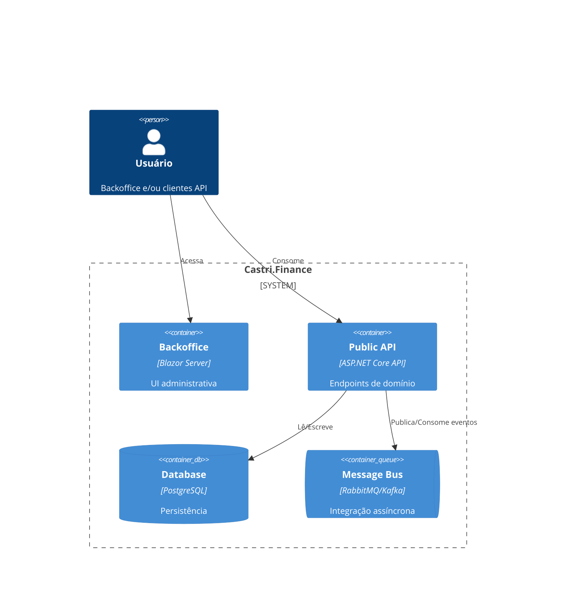

# 📊 Castri.Finance

[](https://dotnet.microsoft.com/)
[](https://github.com/SEU_USUARIO/Castri.Finance/actions)
[](#-testes)
[](LICENSE)

> **Monólito modular (Clean + DDD + CQRS) com prontidão para fatiar em serviços.**  
> Ledger de dupla entrada, billing por uso, dunning, multi-tenant, observabilidade e contratos.

---

## 📌 Sobre o projeto
**Castri.Finance** é um **core financeiro multi-tenant** construído em **.NET 8**, aplicando:
- **Clean Architecture + DDD + SOLID**
- **CQRS + MediatR + Outbox/Inbox**
- **Integração dirigida a eventos** (MassTransit/RabbitMQ ou Kafka)
- **Observabilidade nativa** (Serilog + OpenTelemetry)
- **Prontidão para microserviços** (fatiamento por módulos)

### Funcionalidades iniciais
- 📒 Ledger de dupla entrada (contas e lançamentos)
- 📈 Medição de uso/consumo (tokens, APIs, storage etc.)
- 💰 Billing (recorrência + uso, pró-rata, impostos)
- ⚠️ Dunning (retentativas, estados de fatura)
- 🔐 Multi-tenant authentication & authorization

---

## 🏗️ Estrutura da solução

```
/src
  /BuildingBlocks
    Castri.BuildingBlocks.SharedKernel
    Castri.BuildingBlocks.EventBus
    Castri.BuildingBlocks.Observability
  /Services
    /Identity (Domain, Application, Infrastructure)
    /Ledger   (Domain, Application, Infrastructure)
    /Usage    (Domain, Application, Infrastructure)
    /Billing  (Domain, Application, Infrastructure)
    /Dunning  (Domain, Application, Infrastructure)
  /Web
    Castri.Web.PublicApi
    Castri.Web.Backoffice
    Castri.Web.ApiGateway (opcional)
/tests
  /Unit /Integration /Contract /E2E
/deploy
  docker-compose.yml
/docs
  adr/ | c4-model/
```

> **TFM**: `net8.0` para todos os projetos.  
> **Composition Root** atual: `Castri.Web.PublicApi` (monólito). Fácil migração para serviços dedicados por módulo.

---

## 🚀 Como rodar localmente

### Pré-requisitos
- [.NET 8 SDK](https://dotnet.microsoft.com/download)
- [Docker Desktop](https://www.docker.com/products/docker-desktop/) (opcional, para stack completa)
- PostgreSQL local (ou via docker-compose)

### Passos
```bash
# Clone
git clone https://github.com/SEU_USUARIO/Castri.Finance.git
cd Castri.Finance

# Restore + Build + Run (API)
dotnet restore
dotnet build -c Release
cd src/Web/Castri.Web.PublicApi
dotnet run
```
API: **https://localhost:5001/swagger**

---

## 🧪 Testes

Executar tudo:
```bash
dotnet test -c Release /p:CollectCoverage=true /p:CoverletOutputFormat=opencover
```
Relatórios (artefatos de CI):
- **Cobertura**: `coverage.opencover.xml`
- **TRX**: resultados de teste
- **Pact** (se configurado)

---

## 🛠️ CI/CD Corporativo

Pipeline padrão (GitHub Actions):
1. **Build & Restore**
2. **Testes** (Unit/Integration) + **Cobertura** (Coverlet/OpenCover)
3. **Sonar** (SonarCloud ou SonarQube self-hosted)
4. **Docker Build & Push** (GHCR)
5. **Publicação de artefatos** (test results, coverage, SBOM opcional)

> Configure os **Secrets** do repositório:
> - `SONAR_TOKEN`, `SONAR_PROJECT_KEY`, `SONAR_ORG` (SonarCloud) **ou** `SONAR_HOST_URL` + `SONAR_TOKEN` (SonarQube)
> - `GHCR_USERNAME` (opcional – GHCR funciona com `GITHUB_TOKEN` com permissão `packages: write`)

---

## 📐 Arquitetura (C4 – Container)



---

## 📊 Observabilidade

- **Serilog** (logs estruturados JSON)
- **OpenTelemetry** (traces, métricas) → Tempo/Jaeger/OTLP
- **Prometheus/Grafana** (dashboards)
- CorrelationId em requisições e mensagens

---

## 📚 Documentação

- `/docs/adr` → Decisões arquiteturais (ADR-0001, …)
- `/docs/c4-model` → Diagramas C4
- OpenAPI/Swagger em `PublicApi`

---

## 📌 Roadmap

- [ ] Multi-tenant quotas + billing
- [ ] Relatórios financeiros (PDF/Excel)
- [ ] API GraphQL opcional
- [ ] Dashboard no Backoffice
- [ ] Deploy Kubernetes

---

## 🔒 Licença

MIT – veja `LICENSE`.
